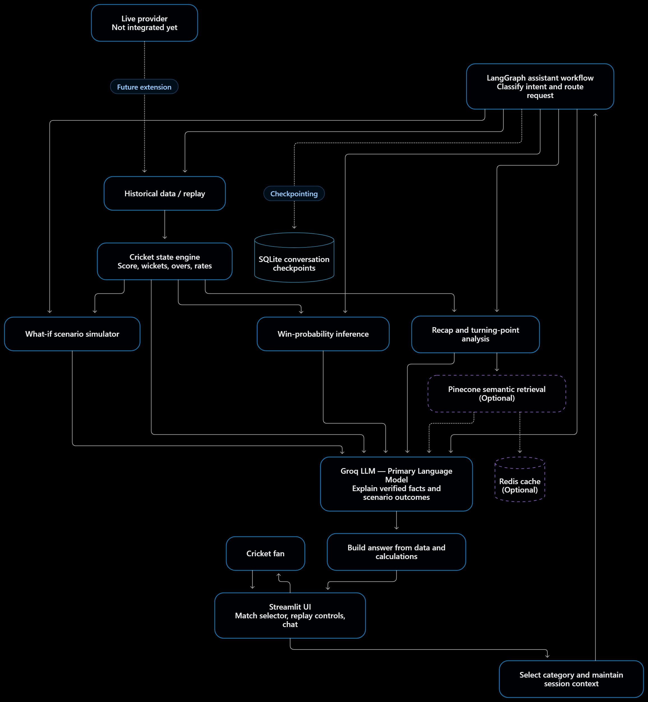
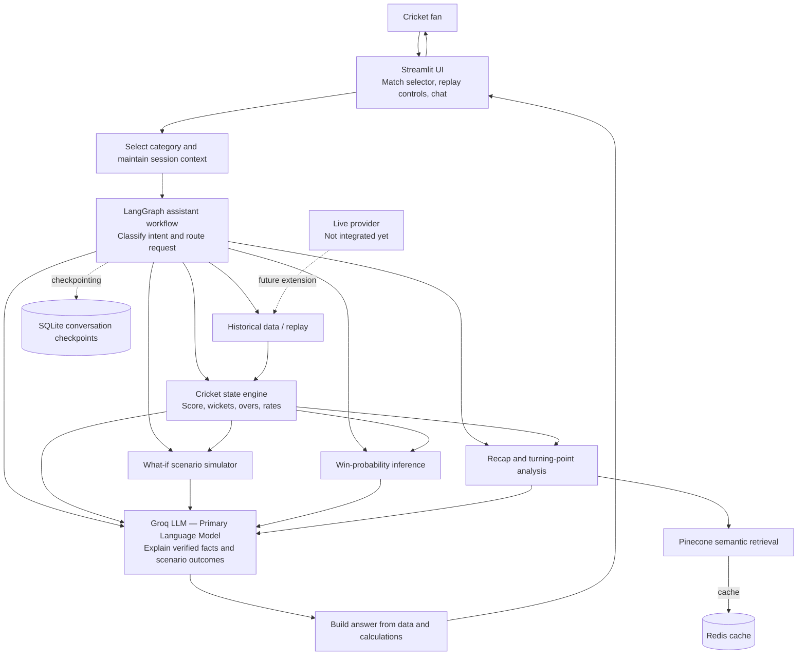

# Fan Companion — Cricket Intelligence & Match Assistant

Fan Companion is an AI-powered cricket companion that helps fans understand match situations, explore hypothetical outcomes, review key moments, and ask natural-language questions about historical T20 matches.

It combines deterministic cricket calculations, ball-by-ball historical data, a machine-learning win-probability model, and language-model explanations in a conversational Streamlit app.

> **Data note:** The app works on historical data and replay. It is **not** a real-time live-score service unless a live-data provider is integrated and verified. Scenario results are hypothetical simulations. Win probabilities are model estimates.

## Project goals

Cricket fans often have to combine scorecards, commentary, run-rate maths, and statistics to understand a match. Fan Companion brings these into one conversational experience, built around:

1. **Explainability** — explain a match situation using score-derived facts.
2. **Interactivity** — support follow-up questions within a selected category.
3. **Scenario analysis** — explore "what if" delivery outcomes without modifying historical data.
4. **Historical analysis** — replay and analyze available deliveries.
5. **Predictive insight** — estimate win probability from a trained model.
6. **Transparency** — keep historical facts, model estimates, and simulated outcomes clearly separate.

## Features

The app groups its features into three categories.

### A. Match Understanding and Analysis

| Feature | Description |
|---|---|
| **AI Match Assistant** | Natural-language Q&A over the selected match. A LangGraph workflow classifies intent and routes each question to the right logic. |
| **Match Situation Explanation** | Explains the current state (score, wickets, overs, runs required, balls remaining, CRR, RRR). Python computes the numbers; the LLM explains them. |
| **Match Recap Generator** | Produces a readable recap grounded in the loaded match data, without inventing missing events. |

### B. Live Match Companion

> These features operate on replayed or supplied state. A verified live provider is required before calling them real-time.

| Feature | Description |
|---|---|
| **Match State** | Builds structured state from deliveries, including chase calculations. |
| **Catch-up** | Summarizes relevant available match events. |
| **Ball-by-ball Explanations** | Explains a delivery using batter, bowler, runs, extras, wicket, and match-state context. |
| **AI Event Narration** | Narrates a structured event, with a deterministic fallback when the LLM is unavailable. |

### C. Match Intelligence and Predictive Analysis

| Feature | Description |
|---|---|
| **What-if Scenario Simulation** | Simulates a hypothetical delivery (dot, single, boundary, wicket, wide, no-ball) on a *copy* of the current state. |
| **Turning-point Detection** | Flags deliveries that most changed the match outlook. This is an analytical signal, not proof of what decided the match. |
| **Win Probability** | Estimates the chasing team's win probability using a trained scikit-learn pipeline. Clear terminal states are handled deterministically. |

The scenario simulator is a prototype and does not yet model every rule (all dismissal types, free hits, penalty runs, Duckworth–Lewis–Stern adjustments).

## Architecture



*The live provider is a future extension and is not integrated yet.*

<details>
<summary>Editable diagram source (Mermaid)</summary>



</details>

### Request lifecycle

1. The fan selects a match and a conversation category in Streamlit.
2. The session and match context are passed into the LangGraph workflow.
3. The workflow routes the question to the appropriate analysis component.
4. Python handles cricket calculations and scenario transitions; the win-probability model handles estimates.
5. The Groq LLM explains the resulting facts in natural language, Pinecone retrieves relevant match summaries, and Redis caches retrieval results.
6. The answer is returned in chat, keeping history, estimates, and simulations distinct.

### Design principles

- **Deterministic calculations first** — Python does the arithmetic and state transitions; the LLM only explains.
- **Bounded workflow** — questions are routed to specific functionality rather than unrestricted tool use.
- **Match-context isolation** — questions are tied to the selected match and session.
- **Separate reality from simulation** — hypothetical outcomes are never written into historical deliveries.
- **Graceful fallback** — if an external service (Groq, Pinecone, Redis) fails, the app returns a deterministic answer or an explicit "unavailable" message.
- **Grounded answers** — no invented squads, commentary, or live status.

## Technology stack

| Layer | Technology | Responsibility |
|---|---|---|
| UI | **Streamlit** | Chat, category/match selection, replay and state display |
| Language | **Python** | Application logic and cricket calculations |
| Data | **Pandas, NumPy** | Loading and processing historical deliveries |
| Orchestration | **LangGraph** | Intent routing and conversational workflow |
| LLM | **Groq API** | Explanations, recaps, and event narration |
| ML | **scikit-learn, joblib** | Win-probability training, inference, and model persistence |
| Persistence | **SQLite** (LangGraph checkpointer) | Local conversation checkpoints |
| Cache | **Redis** | Caching of retrieval results |
| Vector search | **Pinecone** | Semantic retrieval of match summaries |
| Charts | **Altair** | Visualizations |

**Core:** Streamlit, Pandas/NumPy, LangGraph, Groq, Pinecone, Redis, the historical data, and the cricket modules.
**Model-dependent:** win probability needs the trained `models/win_probability.joblib`.

## Project structure

```text
fan_companion/
├── app.py                                  # Streamlit entry point
├── config.toml                             # Streamlit theme
├── requirements.txt
├── data/
│   ├── database/
│   │   └── chat_checkpoints.sqlite         # created at runtime; do not commit
│   └── processed/
│       ├── deliveries.csv                  # processed ball-by-ball data
│       └── win_probability_dataset.csv     # generated training dataset
├── models/
│   └── win_probability.joblib              # trained model artifact
├── docs/
│   └── architecture.png                    # architecture diagram
├── t20s_male_json/                         # raw T20 match JSON files
├── src/
│   ├── assistant/
│   │   ├── graph.py                        # LangGraph conversational workflow
│   │   ├── checkpoint_store.py             # SQLite checkpoint setup
│   │   ├── match_explainer.py              # LLM-backed explanations
│   │   └── redis_cache.py                  # Redis cache
│   ├── cricket/
│   │   ├── historical_match.py             # historical data and replay
│   │   ├── match_state.py                  # deterministic state calculations
│   │   ├── match_explanation.py            # situation explanation
│   │   ├── match_summary.py                # summary data preparation
│   │   ├── match_summary_generator.py      # summary generation
│   │   ├── scenario_simulator.py           # hypothetical delivery simulation
│   │   ├── scenario_analysis.py            # scenario analysis wrapper
│   │   ├── turning_points.py               # turning-point logic
│   │   ├── historical_turning_points.py    # turning points on historical data
│   │   ├── prepare_win_probability_data.py # training-data preparation
│   │   ├── train_win_probability.py        # training and evaluation
│   │   ├── predict_win_probability.py      # inference
│   │   ├── summary_embeddings.py           # Pinecone embeddings
│   │   └── summary_retriever.py            # semantic retrieval
│   └── data/
│       ├── historical_loader.py            # reads raw match JSON
│       └── normalizer.py                   # builds deliveries.csv
├── tests/                                  # pytest suite
└── .env                                    # local secrets; never commit
```

## Data and model workflow

### Historical delivery data

The app reads `data/processed/deliveries.csv`, generated from the match files in `t20s_male_json/`. Columns:

`match_id`, `match_type`, `teams`, `innings`, `batting_team`, `over`, `delivery_in_over`, `batter`, `bowler`, `non_striker`, `batter_runs`, `extra_runs`, `total_runs`, `extras_json`, `wicket`, `wicket_details_json`

To regenerate it from the raw JSON:

```powershell
python -m src.data.normalizer
```

### Win-probability model

1. Read historical match JSON from `t20s_male_json/`.
2. Prepare training examples from eligible completed matches.
3. Filter out matches that don't support the target definition.
4. Split **by match** (not by delivery) to avoid leakage.
5. Train a scikit-learn pipeline and evaluate on held-out matches.
6. Save the model for inference.

Outputs:

```text
data/processed/win_probability_dataset.csv
models/win_probability.joblib
```

A model file existing does not prove it is valid. Check the training metrics, the positive-class definition, and calibration before trusting predictions.

## Installation

### Requirements

- Python 3.12 (used in development)
- Git
- Groq API key, a Pinecone account with an index, and a running Redis server

### Setup (Windows PowerShell)

```powershell
git clone https://github.com/nirajg5/fan_companion.git
cd fan_companion

py -3.12 -m venv .venv
.\.venv\Scripts\Activate.ps1
python -m pip install --upgrade pip
python -m pip install -r requirements.txt
```

### Setup (macOS / Linux)

```bash
git clone https://github.com/nirajg5/fan_companion.git
cd fan_companion

python3.12 -m venv .venv
source .venv/bin/activate
python -m pip install --upgrade pip
python -m pip install -r requirements.txt
```

Verify the install:

```bash
python -m pip check
python -c "import numpy, pandas, streamlit, altair, sklearn, langgraph; print('Core imports successful')"
```

If Windows reports a NumPy DLL blocked by an application-control policy, don't disable security controls. Use an approved Python environment or ask your administrator.

## Configuration

Create a `.env` file in the project root. **Never commit it.**

```env
# Groq (LLM explanations, recaps, narration)
GROQ_API_KEY=your_groq_api_key
GROQ_MODEL=                         # optional; falls back to the built-in default
GROQ_MAX_COMPLETION_TOKENS=         # optional; integer, minimum 100

# Pinecone (semantic retrieval)
PINECONE_API_KEY=your_pinecone_api_key
PINECONE_INDEX_NAME=matchpulse-summaries   # default

# Redis (cache)
REDIS_URL=redis://localhost:6379/0         # default
```

| Variable | Required | Purpose |
|---|---|---|
| `GROQ_API_KEY` | For LLM features | Authenticates with Groq |
| `GROQ_MODEL` | No | Overrides the default Groq model |
| `GROQ_MAX_COMPLETION_TOKENS` | No | Caps response length (integer ≥ 100) |
| `PINECONE_API_KEY` | Yes | Authenticates with Pinecone |
| `PINECONE_INDEX_NAME` | No | Pinecone index (default `matchpulse-summaries`) |
| `REDIS_URL` | No | Redis connection (default `redis://localhost:6379/0`) |

**Pinecone notes:** summaries are stored in the `match-summaries` namespace and embedded with `multilingual-e5-large`, so the index must use **1024 dimensions**.

Never paste API keys into source files, screenshots, issues, or public commits.

## Run the application

With the virtual environment active, from the project root:

```bash
python -m streamlit run app.py
```

If Streamlit's file watcher raises a Windows resource error:

```bash
python -m streamlit run app.py --server.fileWatcherType none
```

Open the local URL printed in the terminal.

### First-use flow

1. Type `hi` to open the menu.
2. Choose one of the three categories, then a feature.
3. Ask a question and continue with follow-ups.
4. Type `menu` to return to the categories, or `exit` to close the conversation.
5. Use the sidebar match and replay controls where available.

## Prepare and train the model

A trained model and dataset are already included in the repository. To rebuild them:

```bash
python -m src.cricket.prepare_win_probability_data
python -m src.cricket.train_win_probability
```

Review the output and confirm both artifacts were created. Don't use predictions if training failed or the saved model is incompatible with your scikit-learn version.

### Evaluation recommendations

- Keep all states from a match in the same split.
- Check for target leakage and the positive-class definition.
- Report Brier score and log loss, not just accuracy or ROC-AUC.
- Check calibration; don't call probabilities calibrated unless it was evaluated.
- Evaluate early, middle, and late chase phases separately.
- Compare against a simple baseline.

## Testing

```bash
python -m pytest tests
```

The suite covers assistant routing, follow-up resolution, historical integration, match state, summary generation, scenario simulation and analysis, SQLite checkpointing, turning points, and win probability. Unit tests don't replace end-to-end testing with the full dataset and configured services.

## Example questions

- "Which team is in a stronger position?"
- "Explain the current match situation."
- "How many runs are required, and how many balls remain?"
- "Summarise the innings so far."
- "Explain the last available delivery."
- "What would happen if the next ball were a six?"
- "Compare a dot ball with a single in this situation."
- "Which delivery changed the match outlook the most?"
- "What is the estimated win probability from the current state?"

Results depend on the selected match, available data, model, and configured services. Missing data is reported rather than fabricated.

## Limitations

Fan Companion is a prototype.

- **No live feed** — replay is not real-time coverage.
- **Data quality** — inconsistent team names, innings labels, extras, wickets, or incomplete deliveries can affect results.
- **Cricket rules** — the simulator does not cover every dismissal, penalty, free hit, super over, or revised target.
- **Probability** — estimates depend on training data, target definition, and model quality.
- **Turning points** — importance depends on the metric and does not establish causality.
- **LLM output** — numeric facts come from deterministic code, but wording can still be imperfect.
- **External services** — API limits, timeouts, or invalid credentials can disable Groq, Pinecone, or Redis features.
